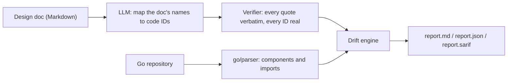
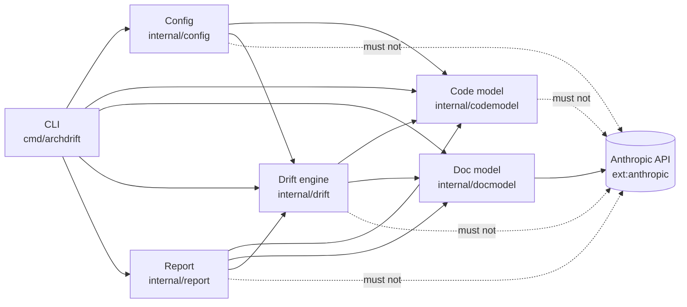

# archdrift

`archdrift` compares a Go repository with a Markdown design doc and reports architecture drift. Every finding carries evidence: `file:line` from the code and/or a verbatim quote from the doc.

**Core principle:** the LLM only reads the doc and maps the doc's names onto code IDs. Code facts (components, imports) and every drift conclusion come from deterministic Go code. Only the doc text and the list of component IDs go to the API, never source code.



The LLM receives the doc and the list of component IDs (`cmd/api`, `internal/orders`, `ext:postgres`, ...) and nothing else. Its answer is checked by code before use, and with a reviewed lock file it is not called at all.

## Quick start

Requires Go 1.25+. Only `lock` calls the Anthropic API (`ANTHROPIC_API_KEY`); `check` reads the committed lock and is free and deterministic.

```bash
go install github.com/stmic168/arch-drift/cmd/archdrift@latest
archdrift init  --repo . --doc docs/architecture.md        # config + workflow, no API call (--mode gate for a rules doc)
archdrift lock  --repo . --doc docs/architecture.md        # one API call: review and commit docs/architecture.lock.json
archdrift check --repo . --doc docs/architecture.md        # exit 0 no drift, 1 drift, 2 error
```

Try it offline on the fixture:

```bash
go build -o archdrift ./cmd/archdrift
./archdrift check --repo testdata/shop --doc testdata/shop/design.md --doc-model testdata/shop/docmodel.json --out /tmp/shop-report
```

## Findings

| Type | Severity | Fails | Meaning |
|---|---|---|---|
| `FORBIDDEN_EDGE` | high | yes | the doc forbids A depending on B, the code imports it |
| `MISSING_COMPONENT` | medium | yes | a doc component maps to no code |
| `MISSING_EDGE` | medium | yes | the doc requires A to depend on B, no import exists |
| `UNDOCUMENTED_EDGE` | low | yes (configurable) | an import between documented components that the doc does not mention |
| `UNDOCUMENTED_COMPONENT` | info | no (configurable) | a code component the doc does not describe |
| `UNVERIFIABLE` | info | never | a runtime relation (HTTP, gRPC, Kafka, ...) static imports cannot prove |

The full rules are in [How it works](docs/guide/how-it-works.md#pipeline).

## Architecture

archdrift's own packages, as a dependency diagram: each solid arrow means "depends on", and a dotted `must not` arrow is a rule. The `%% archdrift: dependencies` line lets archdrift read this diagram by code, with no LLM. CI runs `archdrift check --repo . --doc README.md --no-llm --config archdrift.readme.json` on every pull request, so a new import between packages, a new package, or a package other than the Doc model importing the Anthropic SDK fails the build until this diagram (and, for rules, [ADR-001](docs/architecture-rules.md)) is updated.



## Documentation

| Guide | Contents |
|---|---|
| [Usage](docs/guide/usage.md) | `init`, commands and flags, exit codes, the lock file workflow, the baseline |
| [Configuration](docs/guide/configuration.md) | choosing report or gate mode, every `archdrift.json` field |
| [CI and pull requests](docs/guide/ci.md) | the GitHub Action, `--base` diff mode, SARIF |
| [How it works](docs/guide/how-it-works.md) | what is sent to the API, code model, doc model, verifier, drift rules, report, limitations |
| [Development](docs/guide/development.md) | status, layout, tests, this repository's CI, releases, pilots, offline evaluation |
| [Changelog](CHANGELOG.md) | what each release contains |
| [Roadmap](docs/ROADMAP.md) | what is done and what comes next |

This repository checks itself against [ADR-001](docs/architecture-rules.md) and the architecture diagram above on every pull request.

## License

[MIT](LICENSE)
