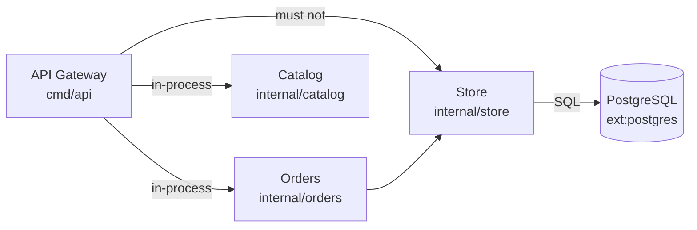

# Usage

[README](../../README.md) · [Usage](usage.md) · [Configuration](configuration.md) · [CI and pull requests](ci.md) · [How it works](how-it-works.md) · [Development](development.md)

## Requirements

- Go 1.25+ (required by `github.com/anthropics/anthropic-sdk-go/v2`; with an older Go installed, the toolchain is downloaded automatically)
- For the live path: Anthropic credentials (`ANTHROPIC_API_KEY`, or any source the SDK resolves, e.g. `ant auth login`)
- The only external dependency is the official `anthropic-sdk-go`; parsing uses the stdlib `go/parser`

## Getting started

```bash
go install github.com/stmic168/arch-drift/cmd/archdrift@latest
archdrift init --repo . --doc docs/architecture.md            # overview doc: report mode
archdrift init --repo . --doc docs/architecture-rules.md --mode gate   # rules doc (ADR)
```

`init` makes no API call. It:

- proposes `archdrift.json`: components for top-level directories outside `cmd/`, `internal/`, `pkg/` (one per child directory, or one for the whole directory when it has more than 10 children, e.g. `common/`), excludes for test, tooling and mock directories, and the options for the mode (`undocumented_edges.fail: false`; in gate mode also `strict_protocols`);
- writes `.github/workflows/archdrift.yml` at the git root, using the action with `upload-sarif`, pinned to the release `init` was installed from (`@main` for a development build);
- in gate mode, starts the rules doc from an ADR template listing the detected components, if it does not exist;
- prints the coverage and the next steps (`lock`, review, `check`, `baseline`, commit). Existing files are kept unless `--force`.

On Temporal (a `service/`, `common/`, `api/` layout) it proposes 23 components with 89% coverage, against 5% for the default layout.

## Commands

```bash
go build -o archdrift ./cmd/archdrift
```

```bash
./archdrift check --repo <path> --doc <design.md> [--out <dir>] [--model <id>] [--doc-model <json>] [--lock <path> | --no-lock]
./archdrift lock  --repo <path> --doc <design.md> [--out <dir>] [--model <id>] [--doc-model <json>] [--lock <path>] [--fresh]
./archdrift baseline --repo <path> --doc <design.md> [same flags as check]
./archdrift scan --repo <path> [--config <json>] [--json]
./archdrift init --repo <path> --doc <design.md> [--mode report|gate] [--force]
```

`scan` prints the code model only (components, which are deployables, packages, import edges in and out) without reading a doc or calling the API. Use it to see how archdrift sees a repo and to write `archdrift.json`.

| Flag | Default | Meaning |
|---|---|---|
| `--repo` | required | Go repo root (must contain `go.mod`) |
| `--doc` | required | Markdown design doc (Mermaid blocks are fine). Repeat it to read several files as one doc; findings then name the file each quote came from. |
| `--out` | `archdrift-out` | output dir: `report.md`, `report.json`, `cache/` |
| `--model` | `claude-sonnet-5-5` | Claude model used for doc extraction |
| `--doc-model` | | load a recorded doc model JSON and skip the API (ignores any lock) |
| `--lock` | next to the doc (`design.md` -> `design.lock.json`) | lock file to read (`check`) or write (`lock`) |
| `--no-lock` | | `check` only: ignore the lock and extract from the doc |
| `--no-llm` | | build the doc model only from dependency diagrams in the doc ([below](#dependency-diagrams-no-llm)); no API call. Not with `--doc-model`. |
| `--config` | `archdrift.json` at the repo root, if present | per-repo configuration ([Configuration](configuration.md)) |
| `--baseline` | `archdrift.baseline.json` at the repo root, if present | accepted known drift ([Baseline](#baseline-archdriftbaselinejson)) |
| `--base` | | `check` only: git revision to compare with (e.g. `origin/main`). Only drift introduced or worsened since then fails ([CI and pull requests](ci.md)). |
| `--sarif-root` | `--repo` | `check` only: directory SARIF paths are relative to; set it to the checkout root when `--repo` is a subdirectory |
| `--today` | current UTC date | `YYYY-MM-DD` used for baseline expiry; set it for reproducible runs |

Exit codes: `check` returns `0` no drift, `1` drift, `2` error; `lock` and `baseline` return `0` written, `2` error. `UNVERIFIABLE` findings never fail the check.

## Lock file (recommended workflow)

The LLM mapping can differ between uncached runs. To make `check` deterministic and free, lock the mapping once:

1. `archdrift lock --repo . --doc docs/design.md` calls the API once and writes `docs/design.lock.json`. It prints a review: each doc component with its code IDs, every relation, code IDs nothing maps to, and claims that failed verification (these are not written).
2. Review the mapping, edit the lock by hand if needed, and commit it.
3. `archdrift check --repo . --doc docs/design.md` now reads the lock and never calls the API. The report shows `Doc model source: lock`.

Rules:

- The lock stores the doc's SHA-256. If the doc changes, `check` exits 2 with "lock file is stale"; re-run `archdrift lock`.
- Re-running `lock` keeps the review. If the doc is unchanged it does nothing (no API call). After a doc edit it extracts again and merges: reviewed claims whose quote is still in the doc are kept as they are, new ones are added, and claims whose quote is gone are removed. It prints "Changes since the previous lock" with `conflict` (reviewed claim kept, the model now suggests something else), `added`, `removed` and `kept` (still in the doc but not extracted this time) lines, so only the changes need review. `--fresh` ignores the previous lock.
- If code components were added or removed since the lock was written, `check` still runs and adds a note at the top of the report. New components show as `UNDOCUMENTED_COMPONENT` until you re-lock; mappings to removed components are dropped as unknown code IDs.
- The verifier runs on every `check`, so a hand edit with a quote that is not in the doc or an unknown code ID is dropped and listed, not trusted.
- Without a lock next to the doc, `check` extracts live as before. `--no-lock` forces that, `--doc-model` overrides both.

Offline demo on the fixture:

```bash
./archdrift check --repo testdata/shop --doc testdata/shop/design.md --doc-model testdata/shop/docmodel.json --out /tmp/shop-report
```

Output on the fixture:

```
archdrift: drift detected: 5 failing finding(s), 1 unverifiable, 3 dropped claim(s)
report: /tmp/shop-report/report.md
```


## Dependency diagrams (no LLM)

A Mermaid flowchart that holds the line `%% archdrift: dependencies` is read by Go code instead of the LLM. In such a block every arrow means "depends on":



- **Nodes** are doc components. Code IDs go after a line break in the label (`Name<br/>id`, several separated by commas); a node without IDs is a component with no code (`MISSING_COMPONENT`), and an unknown ID is dropped and listed like any other.
- **Arrows** (`-->`, `-.->`, `==>`, chains, `a --> b & c`) are required relations. An arrow labelled `must not`, `never`, `forbidden` or `not allowed` is a forbidden relation; any other label is the protocol (`HTTP`, `Kafka`, ...), with the same rules as a protocol the LLM reads.
- **Quotes** are the diagram's source lines, so the verifier and the report work as usual.

How it is used:

- With `--no-llm`, the diagrams are the whole doc model: no API key, no cost, and the same result every run. `lock --no-llm` writes a lock from them.
- Without it, a marked diagram is added to what the LLM read from the prose: its code IDs fill components the LLM left unmapped, and its arrows are added where the LLM has no relation between the same two components. So the diagram's rules hold even when an uncached LLM run misses one.
- Diagrams without the marker are left to the LLM. Arrows in ordinary diagrams often show data flow (`producer --> queue --> consumer`), which is not the direction of the dependency; the marker is the doc author's statement that this diagram is about dependencies.
- The as-built diagram in every report carries the marker and the code IDs, so it can be pasted into the doc and read back. `testdata/shop/design-diagram.md` states the fixture's rules this way and gives exactly the findings of the LLM path on `design.md`.

## Baseline (`archdrift.baseline.json`)

A real repo usually has drift on day one. The baseline accepts known drift so that only new drift fails the check.

1. `archdrift baseline --repo . --doc docs/design.md` writes every current failing finding to `archdrift.baseline.json`. New entries get the reason `TODO: explain why this drift is accepted` and expire in 90 days. Re-running keeps the reason and expiry of entries that still match.
2. Replace each TODO with the real reason (for example a ticket), adjust `expires`, and commit.

```json
{
  "version": 1,
  "accepted": [
    {"id": "FORBIDDEN_EDGE:API Gateway -> Store", "reason": "Legacy path, removal tracked in ARCH-42", "expires": "2027-01-31"}
  ]
}
```

On `check`:

- An accepted finding does not fail the check. It moves to an "Accepted drift (baseline)" table in the report with its reason, expiry and evidence, and is counted as `accepted` (not in `by_type`).
- An entry is valid through its `expires` date (optional; omit it for no expiry). After that the finding fails again and the report says so.
- The report also notes entries that no longer match any finding (remove them) and entries still holding the TODO reason.
- `id` is the finding's `id` from `report.json`. A missing explicit `--baseline` is an error, so a typo cannot silently fail every accepted finding.
